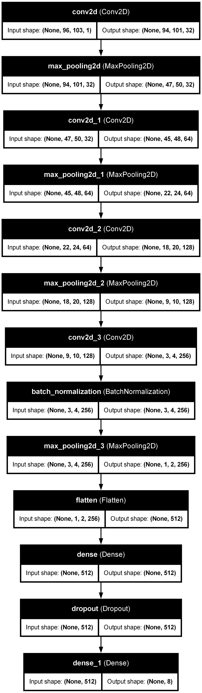
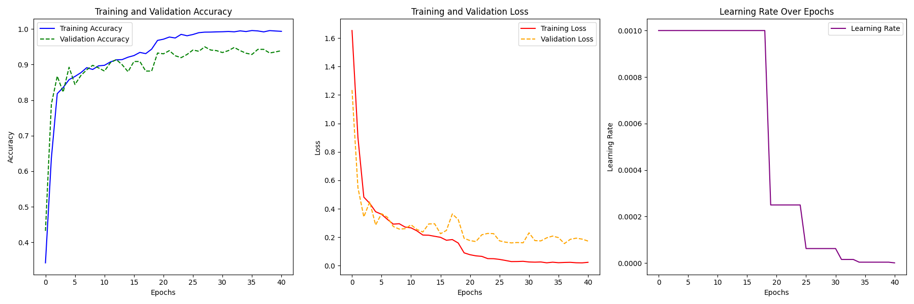
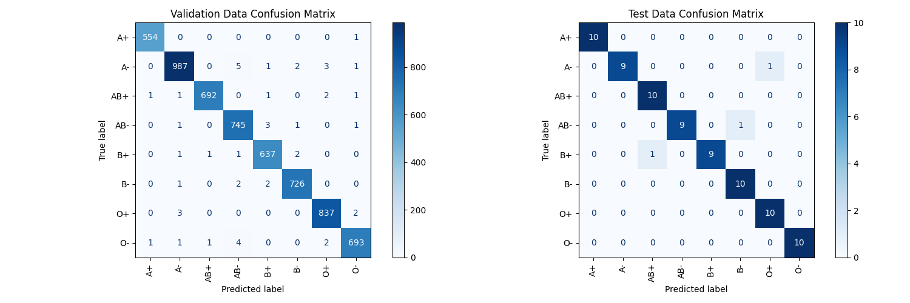

# CNN For Blood Group Detection using Fingerprint

A CNN-based project that predicts a person's blood group from a fingerprint image, with training/evaluation utilities and a simple web UI demo.

> ⚠️ **Important (Medical Disclaimer):** This is an educational/research prototype and **must not** be used for medical decisions. Scientific evidence for strong fingerprint ↔ blood-group correlation is mixed/weak; treat predictions as non-clinical experimentation only.

---

## What’s in this repository

The repository contains scripts for training, evaluation/visualization, and a small demo front-end:

- **Training**
  - `CNNTraining.py` — train a CNN model and save it (Keras format).
- **Preprocessing**
  - `ImagePreprocessing1.py`, `ImagePreprocessing2.py` — image cleanup/prep steps for fingerprint images.
- **Evaluation**
  - `testing.py` — run inference / quick testing.
  - `getConfusionMatrix.py` — generate confusion matrix visualization.
- **Visualization**
  - `VisualizeModel.py` — export/visualize the model architecture.
  - `GetGraphFromCSV.py` — plot accuracy/loss curves from training logs.
- **Demo**
  - `server.py` — backend server for demo (commonly Flask/FastAPI style).
  - `index.html` — simple browser UI.

### Included artifacts (already in repo)
- `savedModel.keras` — saved Keras model.
- `training_log.csv` — training history log.
- `accuracy_loss_lr_plot.png` — training curves plot.
- `confusion_matrix.png` — confusion matrix image.
- `model_architecture.png` — model architecture diagram.

---

## Demo screenshots

### Model architecture


### Training curves


### Confusion matrix


---

## Tech stack (typical)
This project uses Python and a Keras model format (`.keras`), which usually implies **TensorFlow/Keras** for training/inference.  
The preprocessing scripts commonly rely on image libraries such as OpenCV/Pillow, and the demo server typically uses Flask/FastAPI.

> If any import fails, install the missing dependency and re-run.

---

## Getting started

### 1) Clone the repository
```bash
git clone https://github.com/GalexyBrain/CNN-For-Blood-Group-Detection-using-fingerprint.git
cd CNN-For-Blood-Group-Detection-using-fingerprint
````

### 2) Create a virtual environment (recommended)

```bash
python -m venv .venv
# Windows:
.venv\Scripts\activate
# macOS / Linux:
source .venv/bin/activate
```

### 3) Install dependencies

There is no `requirements.txt` in the repo, so install the usual packages used by CNN + image + web demo projects:

```bash
pip install --upgrade pip
pip install tensorflow numpy pandas scikit-learn matplotlib pillow opencv-python
# If server.py is Flask-based:
pip install flask
# If server.py is FastAPI-based:
pip install fastapi uvicorn
```

---

## Dataset

This repository does not bundle a full dataset. You’ll need a labeled fingerprint dataset where each image maps to a blood-group class.

A common approach is to arrange data like this:

```
dataset/
  A+/
    img1.png
    img2.png
  A-/
  B+/
  B-/
  AB+/
  AB-/
  O+/
  O-/
```

> Update the dataset path/classes inside `CNNTraining.py` (and other scripts) to match your folder names.

---

## Training

Run the training script:

```bash
python CNNTraining.py
```

Expected outputs (based on repo artifacts) may include:

* `savedModel.keras`
* `training_log.csv`

If training generates plots, you may also see updated:

* `accuracy_loss_lr_plot.png`

---

## Evaluation & testing

### 1) Run inference / test

```bash
python testing.py
```

### 2) Confusion matrix

```bash
python getConfusionMatrix.py
```

This should generate/update:

* `confusion_matrix.png`

---

## Web demo

1. Start the server:

```bash
python server.py
```

2. Open the UI:

* If the server serves the HTML, it will provide a local URL in the terminal.
* Otherwise, open `index.html` directly in a browser and configure the backend endpoint if needed.

> If the demo fails, check `server.py` for the host/port and expected request format (image upload field name, route path, etc.).

---

## Notes, limitations, and ethics

* **Not clinically valid:** Do not use for medical decisions.
* **Biometric privacy:** Fingerprints are sensitive personal data. Don’t publish or share identifiable fingerprint datasets without consent.
* **Generalization:** Performance depends heavily on dataset size, capture conditions, and labeling consistency.

---

## Contributing

PRs are welcome:

* add `requirements.txt`
* add a clear dataset loader config section
* add CLI args to `testing.py` / `CNNTraining.py`
* add Docker support for easier reproducibility

[1]: https://github.com/GalexyBrain/CNN-For-Blood-Group-Detection-using-fingerprint "GitHub - GalexyBrain/CNN-For-Blood-Group-Detection-using-fingerprint: A CNN for detecting Blood Group using an image of the finger print."
